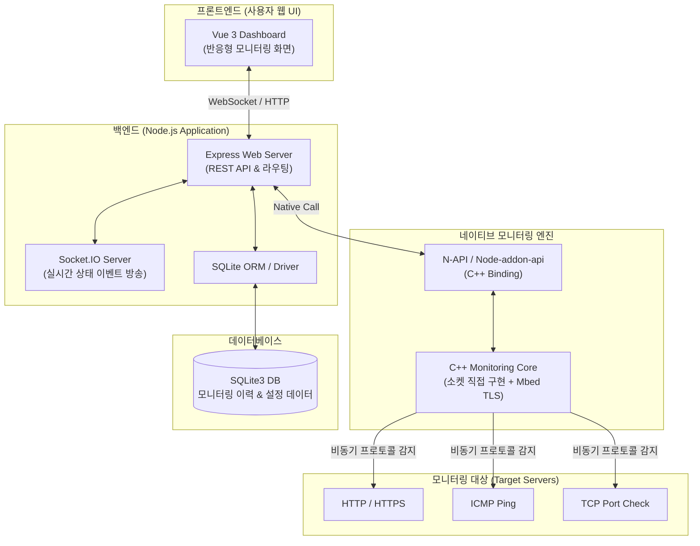

## 실행 순서

```bash
# 1. C++ 감지 엔진 빌드 (처음 한 번, C++ 코드가 바뀌었을 때 다시)
cd engine && npm install && cd ..

# 2. 백엔드 (http://localhost:3000)
cd backend && npm install && npm start
```

- 엔진 빌드에는 Windows의 경우 Visual Studio "C++를 사용한 데스크톱 개발"이 필요합니다. 자세한 내용은 `engine/README.md`
- 백엔드 API, 환경 변수, DB 변경 사항은 `backend/README.md`
